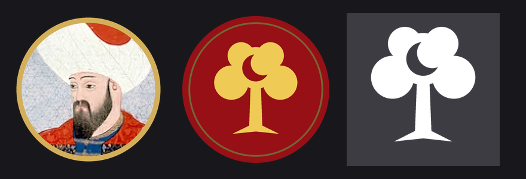
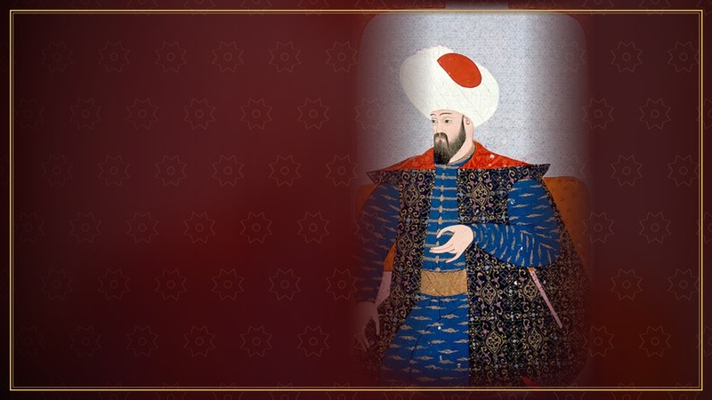
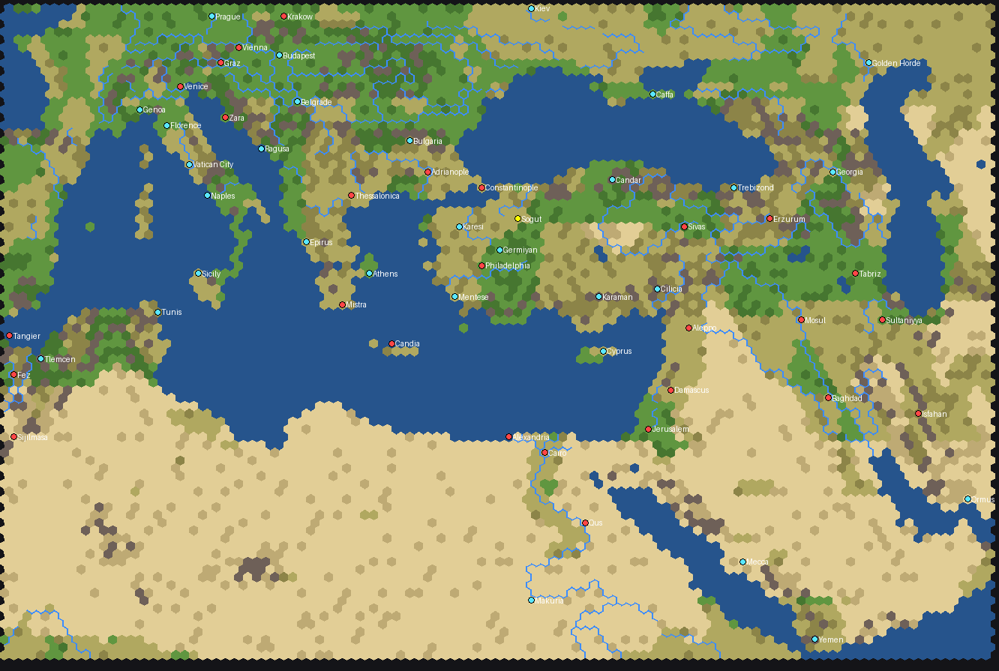

# Osman Bey: Rise of the Ottomans (1299) – Civilization V mod

A mod for *Sid Meier's Civilization V: Brave New World* about the birth of the Ottoman state. It adds **Osman Bey** leading the **Ottoman Beylik**, a real map of the Ottoman world in 1299, and a scenario that starts with the powers and city-states of that year.



The repository holds two mods:

| Folder | What it is |
|---|---|
| `Osman Bey/` | The civilization, its unique units and buildings, music and the **Ottoman Frontiers (1299)** map. Works in any normal game. |
| `Osman Bey 1299 Scenario/` | The **Rise of the Ottomans: 1299** scenario. Needs the `Osman Bey` mod. |

## The civilization

| | |
|---|---|
| **Leader** | Osman Bey (Osman I, c. 1258 – 1323/24) |
| **Ability: Osman's Dream** | Captured cities have no resistance and pay Gold equal to 10 × their population (*istimalet*, "winning over"). Land units get +25% strength against cities. Embarked units get +1 movement and landing costs 1 movement, so the Dardanelles and the Bosphorus are crossed quickly. Great Generals are earned 50% faster. |
| **Akinji** (Turkish *akıncı*, replaces Knight) | Ottoman Sipahi model. Strength 24, 5 movement, no Horses needed, 10% cheaper, +1 sight, pillages without spending movement and heals when it pillages. |
| **Janissary / Yeniçeri** (replaces Musketman) | Strength 28, heals after destroying an enemy, attack bonus, starts with Drill I. |
| **Great Bombard / Şahi Topu** (replaces Trebuchet) | A cannon (24 ranged strength, cannon model) available with **Mathematics**, long before anyone else has gunpowder artillery. |
| **Grand Bazaar / Kapalıçarşı** (replaces Market) | +3 Gold, +1 Culture, +1 Happiness on top of the Market. |
| **Mosque / Cami** (replaces Temple) | +2 Faith, +2 Culture, +1 Happiness on top of the Temple, lower upkeep. |
| **Kervansaray** (replaces Caravansary) | +2 Gold and +1 Culture on top of the trade-route bonuses. |
| **Medrese** (replaces University) | +3 Science, +2 Culture and +1 Faith on top of the University. |
| **Tophane** (replaces Armory) | +1 Production and +25% Production for gunpowder and siege units, on top of the experience bonus. |

Each also has Civilopedia text, a Dawn of Man screen, diplomacy lines, 38 city names (Sögüt, Bursa, Iznik, …) and spy names. The Ottoman Beylik has its own soundtrack: two peace tracks, two war tracks and a diplomacy track.



## The map: Ottoman Frontiers (1299)



- 110 × 84 hexes covering the lands the Ottomans reached at their height: **from Vienna to Yemen and from Morocco to the Caspian Sea**, including North Africa, the Black Sea coasts, the Caucasus, Mesopotamia and western Iran.
- Coastlines, lakes, deserts and mountain ranges come from [Natural Earth](https://www.naturalearthdata.com/). The **rivers are real** too: the Nile, Danube, Euphrates, Tigris, Kızılırmak, Sakarya, Dnieper, Don, Volga and around a hundred more run along hex edges.
- Anatolia and the Balkans are slightly enlarged and the Sahara and Arabia slightly compressed, so the Ottoman heartland has room for cities while coastlines stay recognisable.
- The Bosphorus, Dardanelles, Gibraltar, Bab-el-Mandeb, Kerch and Hormuz straits are open; Suez is land.
- **Historical start positions** (default): every civilization with a home on the map starts there (Osman at Sögüt near Bursa, Byzantium at Constantinople, …), and city-states such as Ragusa, Genoa, Budapest or Kiev are placed at their real locations.
- Recommended size: **Huge**.

## The scenario: Rise of the Ottomans, 1299

- Starts in the **Medieval era** with eight great powers: the **Ottoman Beylik**, the **Byzantine Empire**, the **Ilkhanate** (played by Mongolia), the **Mamluk Sultanate** (Egypt), **Venice**, **Austria**, **Poland** and the **Marinids** (Morocco).
- The great powers start with the cities they held in 1299: Constantinople (with its walls), Thessalonica, Adrianople, Tabriz, Baghdad, Cairo, Damascus, Aleppo, Venice, Candia, Vienna, Fez and more – 27 cities in all. The Ottoman Beylik starts near Bursa with its settlers, two Akinjis and two Great Bombards; Constantinople has its walls but no castle.
- The city-states are those of 1299: the Anatolian beyliks (**Karaman, Germiyan, Karesi, Menteşe, Candar**), **Trebizond, Georgia, Cilician Armenia, Cyprus, Epirus, the Duchy of Athens, the Golden Horde, Genoese Caffa, Bulgaria, Sicily, Naples, Tunis, Tlemcen, Mecca, Rasulid Yemen, Makuria**, plus Ragusa, Genoa, Florence, the Papal States, Budapest, Belgrade, Prague, Kiev and Hormuz – 30 in all.
- You can play any of the eight powers.

## Installation

1. Download the repository (**Code → Download ZIP**) and unpack it.
2. Copy the folders `Osman Bey` and `Osman Bey 1299 Scenario` to
   - Windows: `Documents\My Games\Sid Meier's Civilization 5\MODS\`
   - macOS: `~/Documents/Aspyr/Sid Meier's Civilization 5/MODS/`
3. Start the game and open **MODS**.
   - **Normal game:** enable only **Osman Bey (Ottoman Beylik)**, then **Single Player → Set Up Game**. Pick Osman Bey and, if you like, the map **Ottoman Frontiers (1299)**.
   - **Scenario:** enable both mods, then **Single Player → Custom Game → Rise of the Ottomans: 1299**.

Requires **Brave New World**. The scenario mod removes the city-states that did not exist in 1299, so turn it off again before playing normal games.

## Reporting problems

The mod passes automatic tests outside the game (see below) but has not yet been played through. If something goes wrong:

1. In `Documents\My Games\Sid Meier's Civilization 5\config.ini` set `LoggingEnabled = 1`.
2. Start the game and load the mod.
3. Send **Database.log** and **Lua.log** from `Documents\My Games\Sid Meier's Civilization 5\Logs\`.

## Known limitations

- The leader is a still 2D image, not an animated 3D leader. Civilization V does not play diplomacy voice lines for 2D leaders; the lines appear as text.
- The unique units and buildings use the models and icons of the units they replace (the Janissary uses the Janissary model).
- In the scenario, the Ilkhanate, the Mamluks, Austria, Poland and the Marinids are played by the base-game civilizations Mongolia, Egypt, Austria, Poland and Morocco, with their own leaders.

## Building from source

Everything in the two mod folders is generated by the scripts in `tools/`:

```bash
pip install shapely pillow
python tools/build_map.py <folder with Natural Earth GeoJSON>   # map_grid.txt, map_rivers.txt
python tools/assemble_map.py      # map script
python tools/build_art.py         # leader screens and icons (needs ImageMagick)
python tools/build_mod.py         # game data, text, Lua, scenario
python tools/build_modinfo.py     # .modinfo files with MD5 hashes
python tools/test_sql.py          # loads the real game XML into SQLite and applies both mods
luajit tools/test_lua.lua         # runs the map and scenario scripts against a mock of the game API
```

The Natural Earth layers used are `ne_50m_land`, `ne_50m_lakes`, `ne_50m_geography_regions_polys` and `ne_10m_rivers_lake_centerlines` ([GeoJSON](https://github.com/nvkelso/natural-earth-vector/tree/master/geojson)).

Sources and image credits: [docs/SOURCES.md](docs/SOURCES.md).

---

**Türkçe özet:** Civilization V (Brave New World) için Osman Bey ve Osmanlı Beyliği modu. Akıncı ve Yeniçeri birimleri, Kervansaray, Medrese ve Tophane binaları; Viyana'dan Yemen'e, Fas'tan Hazar'a uzanan gerçek nehirli 1299 haritası ve 1299 dünyasıyla başlayan bir senaryo içerir. Kurulum ve kullanım için yukarıdaki **Installation** bölümüne bakın.
